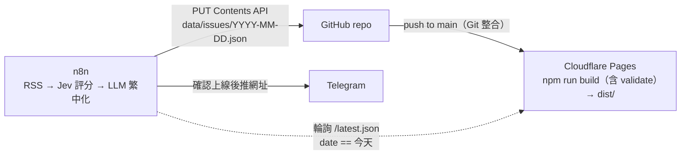

# daily-paper 日報範本

靜態的繁體中文個人日報網站。**n8n** 每天 commit 一份 JSON，**Cloudflare Pages** 透過 Git 整合自動建置並部署。Fork 後改 `site.config.json` 就能變成你自己的報紙。

[English summary below](#english-summary)

> 目前 `data/issues/` 內三期為**虛構的範例資料**（標註「範例」），上線前請刪除。

## 架構



| 角色 | 負責 |
| --- | --- |
| n8n（不在本 repo） | 抓 RSS、評重要性、LLM 改寫、commit JSON、輪詢確認、推 Telegram |
| 本 repo | 驗證、渲染、存檔、提供 `/latest.json` 檢查點（部署由 Cloudflare 的 Git 整合負責） |

## 目錄結構

```
site.config.json          報名、副標、網址、時區、區段（順序／名稱／顏色）、每區上限、主色、頁尾
data/issues/*.json        每天一份，檔名 = 期數日期
schema/issue.schema.json  資料格式
scripts/validate.mjs      build 前驗證（格式錯 → exit 1 → Cloudflare 建置失敗，線上維持上一版）
scripts/build.mjs         單一建置腳本，零相依，輸出 dist/
src/style.css, theme.js   樣式與深色模式切換
```

輸出：`/`（最新期）、`/YYYY-MM-DD/`、`/archive/`、`/feed.xml`、`/latest.json`、`/404.html`、`sitemap.xml`、`robots.txt`。
每頁 `<head>` 都有 `<meta name="issue-date">`：期數頁為該期日期，其他頁為最新一期日期。

## 本機使用

需要 Node 20+，沒有任何相依套件，不需 `npm install`。

```bash
npm run validate   # 驗證 site.config.json 與 data/issues/*.json
npm run build      # 先 validate，再輸出 dist/
npm run dev        # build 後用 npx serve 在 http://localhost:3000 預覽
```

> 網站使用根路徑連結（`/archive/`），請用 `npm run dev` 預覽，不要直接雙擊開啟 `dist/index.html`。

## 設定步驟

1. **Fork** 這個 repo。
2. **Cloudflare 建 Pages 專案**：Workers & Pages → Create → Pages → **Connect to Git**，選你的 fork。設定：
   - Production branch：`main`
   - Build command：`npm run build`（會先 validate 再 build）
   - Build output directory：`dist`
   - 環境變數（建議）：`NODE_VERSION` = `20`
3. **自訂網域**（選用）：專案 → Custom domains，加入你的網域。
4. 不需要任何 GitHub Secrets / Variables，也不需要 Cloudflare API Token。
5. **給 n8n 的 fine-grained PAT**：Settings → Developer settings → Fine-grained tokens，Repository access 只選這個 repo，權限只給 `Contents: Read and write`。
6. **改 `site.config.json`**：報名、副標、`url`（你的 `*.pages.dev` 或自訂網域）、區段、主色、頁尾。
7. 刪除範例資料（目錄留 `.gitkeep`）並 push 到 `main`；沒有任何期數時網站會顯示「尚未發刊」。

> 每次 push 到 `main`，Cloudflare 會自動建置部署。若 `validate` 失敗，該次部署會失敗，線上維持上一版，可在 Cloudflare 的 Deployments 看錯誤訊息。

## n8n commit JSON

`PUT /repos/{owner}/{repo}/contents/data/issues/{date}.json`，`content` 為 base64。**同一天重跑時必須帶 `sha`**（舊檔的 blob sha），否則 GitHub 回 422。

```bash
OWNER=you REPO=daily-paper DATE=2026-11-10
API=https://api.github.com/repos/$OWNER/$REPO/contents/data/issues/$DATE.json

# 1) 取得現有檔案的 sha（不存在則為空）
SHA=$(curl -s -H "Authorization: Bearer $GH_PAT" -H "Accept: application/vnd.github+json" "$API" | jq -r '.sha // empty')

# 2) 建立或更新
curl -X PUT "$API" \
  -H "Authorization: Bearer $GH_PAT" -H "Accept: application/vnd.github+json" \
  -d "$(jq -n --arg m "issue $DATE" --arg c "$(base64 -w0 issue.json)" --arg s "$SHA" \
        '{message:$m, content:$c, branch:"main"} + (if $s != "" then {sha:$s} else {} end)')"
```

n8n 內可用 HTTP Request 節點：先 GET（`Never Error` / 404 視為無檔案），再 PUT。

## 部署確認

push 後 Cloudflare 約 1 分鐘完成建置。n8n 輪詢 `/latest.json`（加亂數參數避免快取，伺服器也已設 `no-store`），等到 `date` 等於今天才推 Telegram：

```
GET https://<你的網址>/latest.json?t={{ $now.toMillis() }}
→ {"date":"2026-11-10","edition":123,"url":"https://…/2026-11-10/"}
條件：{{ $json.date === $now.setZone('Asia/Taipei').toFormat('yyyy-MM-dd') }}
建議：每 30 秒一次，最多 20 次，逾時就通知失敗。
```

## 資料格式

見 `schema/issue.schema.json`。必填：`date`、`generated_at`、`edition`、`headline`、`brief`、`sections`、`stats`；每則 item 必填 `title`、`summary`、`why`、`importance`(1–5)、`source_name`、`source_url`。可選 `image`（https 網址）、`image_alt`。區段 `id` 需對應 `site.config.json`；未知區段會附加在最後並以主色顯示（驗證時警告）。

---

## English summary

A static Traditional-Chinese daily newspaper. **n8n** commits one JSON file per day to `data/issues/YYYY-MM-DD.json` via the GitHub Contents API → **Cloudflare Pages** (Git integration) runs `npm run build` (validate, then `scripts/build.mjs`; Node 20, zero dependencies) and publishes `dist/` → n8n polls `/latest.json` until `date` equals today, then posts the URL to Telegram.

**Setup:** fork → create a Cloudflare Pages project via *Connect to Git* (production branch `main`, build command `npm run build`, output directory `dist`, optional env `NODE_VERSION=20`) → create a fine-grained PAT limited to this repo with *Contents: Read and write* for n8n → edit `site.config.json` → delete the sample issues.

**Commit API:** `PUT /repos/{owner}/{repo}/contents/data/issues/{date}.json` with base64 `content`; include the existing file's `sha` when re-running for the same day. Every push to `main` triggers a Cloudflare build; if validation fails the deploy fails and the previous version stays live.

**Commands:** `npm run validate`, `npm run build`, `npm run dev`.

## License

MIT
